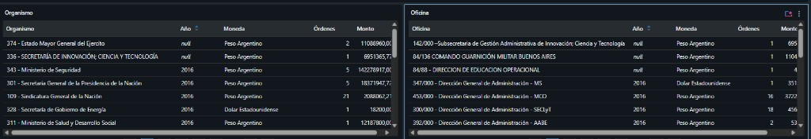

# compras_estado

Compras públicas del Estado nacional, publicadas por COMPR.AR en [datos.gob.ar](https://www.datos.gob.ar/dataset/sistema-de-contrataciones-electronicas).

Catálogo en Databricks: `compras_estado`.

## Fuentes

Dos CSV. Cada uno es una tabla. No se cruzan hasta Silver.

| Archivo | Qué es una fila |
|---|---|
| Adjudicaciones 2016–2026 | Una orden de compra: organismo, proveedor, monto, moneda, fecha |
| Convocatorias 2016–2026 | Un proceso de compra. El objeto de la compra está en `Objeto_del_Proceso` |

El cruce entre los dos es `Numero_Proceso`.

## Capas

```text
landing/     archivo como llegó
bronze/      una tabla por archivo, columnas en texto
silver/      tipos, claves, cruce por proceso
gold/        hecho de la orden de compra y agregados
semantic/    nombre de cada métrica
```

## Cómo se lee

Cada organismo y cada oficina, en su moneda. Pesos y dólares no se suman. El año vacío es una orden que llegó sin ejercicio.


